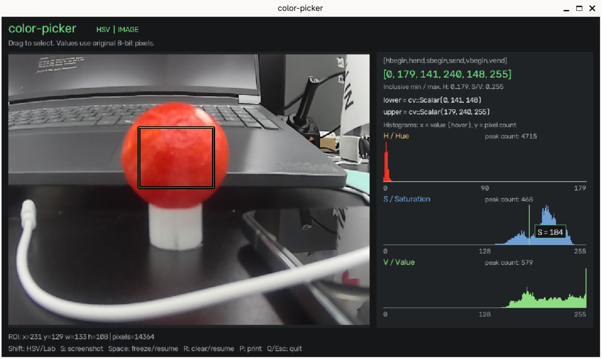

# color-picker · HSV / Lab 取色工具



## Features

- 图形界面纯Opencv HighGUI实现，跨平台跨桌面环境友好(Gnome & xfce已测试)
- UI元素自适应，窗口缩放不影响通道值采集
- C++构建，Fast & Low-cost
- 支持Opencv5，兼容Opencv4
- 支持HSV、Lab色彩通道
- Maixvision风格，简单直观
- 终端格式化输出，可用于AI输入和自动化调参
- 内置快速截图，避免嵌入式环境下截图不便或无截图程序
- Linux嵌入式设备友好
## Build

需要 CMake 3.16+、C++17 编译器，以及启用了 GUI 的 OpenCV 开发包，模块包括 core、imgproc、imgcodecs、highgui、videoio。摄像头需要 V4L2 支持

```bash
git clone https://github.com/ITC-207C-AIoT/color-picker.git
cd color-picker
# -DBUILD_TEST=1 启用测试程序构建（默认关闭）
# -DOpenCV_DIR=<where of opencv cmake package> 指定OpenCV包路径
cmake -S . -B build -DCMAKE_BUILD_TYPE=Release
cmake --build build
```

## Usage

```bash
./build/color-picker                           # 默认 /dev/video0
./build/color-picker --source /dev/video2
./build/color-picker --source ./photo.png
./build/color-picker --source="./my photo.jpg"
./build/color-picker --source /dev/video0 --screenshot-dir ./test-images # 默认截图保存路径为./screenshots/
./build/color-picker --help
```

进入程序后，左侧为图像源预览区，右侧为通道可视区，默认状态下为无数据

- 按住鼠标左键拖拽可新建ROI区域，右侧可视化面板数据会实时更新
- 框选ROI区域后，将鼠标移动到右侧的通道柱状图中可查看某个峰值所在的通道值
- `R` 键可清除图像源预览区的ROI框
- `S` 键可对当前图像进行保存（输入源为视频设备时采集测试图用）
- `P` 键可重新打印终端输出的信息
- `Shift` 可切换Hsv/Lab通道
